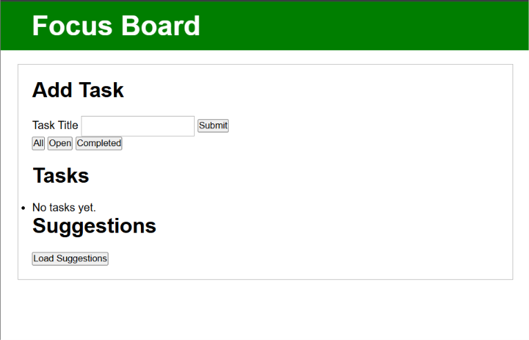

# Focus Board
A small task planner built with plain JavaScript.

## Run
Open index.html in a modern browser (or serve the folder locally).

## Application

## Requirements
To run this project you need:
    A web browser
    A code editor
    Git (For cloning the repository)
    Local server needed

## Checks
1. Add valid task -> appears and survives reload.
2. Duplicate with different casing -> validation appears.
3. Filter Completed -> only completed tasks appear.
4. Load suggestions offline -> error is visible; local tasks remain usable.
5. Export -> downloaded JSON contains current tasks.

## Features

The application supports the following features:

**Add tasks**: Users can create tasks
**Task validation**: Prevents users from submitting empty tasks
**Complete tasks**: Users can mark task as complete
**Delete Tasks**: Users can delete tasks
**Filter tasks**: Users can view tasks based on completion status
**Data persistence**: Saves tasks using local storage so they remain available after refreshing the page

## Project Structure
javascript-four-day-sprint/
├── challenges/
    Discounted_cart_tax.js
    FizzBuzz.js
    Grade_labels.js
    Immutable_toggle.js
    Inheritance_and_composition.js
    Minutes_to_hours.js
    Minutes_to_hours_version2.js
    Purchase_summary.js
    case_insensitive_search.js
    composable_filters.js
    task_statistics.js
├──notes/
    daily-reflections.md
├──src/
    api.js
    app.js
    day_1.js
    storage.js
    task.js
├──index.html
├──README.md
├──stlyes.css

## How To Use The Application
1. Open index.html in your web browser
2. Enter a task in the input field
3. Submit the task
4. Use checkbox to mark as complete
5. Use delete button to delete task
6. Use All/Open/Completed to filter tasks
7. Use load suggestions to load suggested tasks

## Known Limitations
1. Only works locally
2. Load suggestions require internet connection

## Future Improvements
1. User interface
2. Adding duplicate prevention feature
3. Adding task priority
4. Adding search tasks feature

## Hardest Bug
Using the find function to find by ID and accumulator to return based by priority.

## What was learnt
1. Variables and data types.
2. Functions and return values.
3. Conditional statements and loops.
4. Arrays and array methods.
5. Objects and classes.
6. Constructors and methods.
7. Inheritance and composition.

## Test Cases
1. Add a valid task - Task appears in list
2. Add an empty task - Please fill this field message appears
3. Delete a task - Task disappears
4. Refresh browser - Saved tasks remain
5. Mark a task as completed - Task is striked through
6. Click completed - Only completed tasks appear
7. Click open - Only open tasks appear
8. Click All - All tasks appear whether open or completed